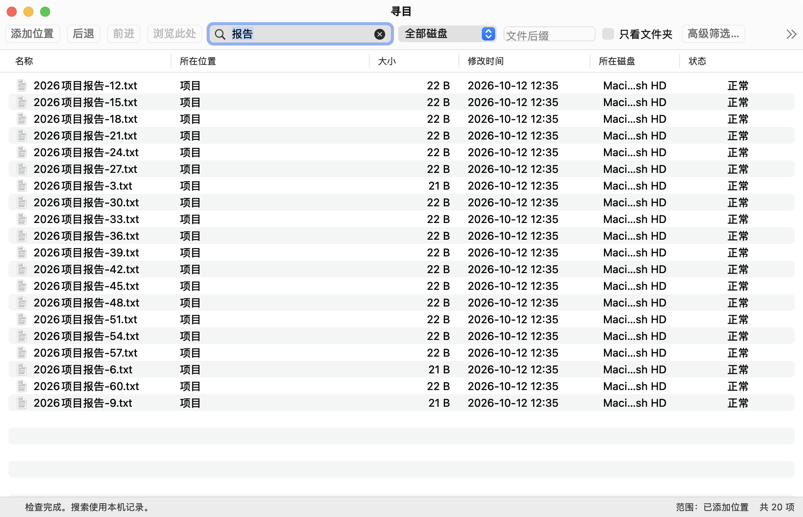

# 寻目 · Xunmu

原生 macOS 文件名搜索工具（曾用名：速寻 / 内部工程代号：MacEverything）。
索引保存在本机，外置盘离线后仍可搜索；打开文件保留搜索窗口，目录范围可以前进、后退。

> 源码仓库：[qitiandashenggogogo/xunmu](https://github.com/qitiandashenggogogo/xunmu)，采用 [MIT 许可证](LICENSE)，
> 许可与第三方声明见 [docs/OPEN-SOURCE.md](docs/OPEN-SOURCE.md)。
> 兼容性说明：为保证与现有本地 SQLite 数据库完全兼容，底层 Swift 包名称、模块 Target（`MacEverything`）、
> 命令行基准（`SearchBench`）与本地数据目录（`~/Library/Application Support/MacEverything`）保持延续，
> 品牌改名不迁移已有数据；应用可执行文件仍为 `MacEverything`。



_上图使用演示夹具数据（合成文件名、小体积、占位卷名），不含真实用户文件。_
_应用图标采用已选定的 **图标 A（文件夹与放大镜，蓝青配色）**，由纯 Swift 矢量绘制脚本（[Scripts/generate-icon-proposals.swift](Scripts/generate-icon-proposals.swift)）原创生成，不依赖任何外部图标库或 AI 素材，可使用 `swift Scripts/generate-icon-proposals.swift` 随时复现生成。预览与对比板见 [docs/branding/icons/](docs/branding/icons/)。_

[上一版截图](docs/app-preview.png) 保留在仓库里作为过程记录；该版本的表头与首行存在重叠渲染，
已在 2026-10-12 修复，上图是修复后的界面。

## 本地构建

需要 macOS 14+ 与支持 Swift 6 的 Apple 开发工具。索引只依赖系统 SQLite；唯一第三方包是 Sparkle（仅用于应用内更新检查，见下文），首次构建需要网络拉取。

```sh
bash Scripts/build-app.sh
open dist/寻目.app
```

首次打开点击“添加位置”，选择要索引的文件夹或外置磁盘。第一次扫描需要读取磁盘目录；之后查询读取本机索引。首次扫描期间可搜索已建立的部分，暂停后可继续。默认不会自动扫描整个内置盘。

演示使用独立的生成夹具，不会扫描您的其他文件：

```sh
open dist/寻目.app --args --demo --data-dir /tmp/MacEverything-demo
```

## 搜索与操作

- 任意位置子串，支持一个或两个汉字；空格分隔多个必含词，`-词` 排除。裸词匹配名称或相对路径；`name:报告` 仅匹配文件名，`path:项目` 限定路径。
- 可用卷、扩展名、文件夹、大小与日期筛选，以及名称、路径、大小和修改时间排序。
- 双击打开文件或 Finder 文件夹，搜索窗口保留；应用内目录范围和后退恢复选区与滚动位置。
- Finder 显示、复制路径、按需 Quick Look；离线结果显示状态，不能直接打开。

索引目录默认在 `~/Library/Application Support/MacEverything`。数据库与用户原始文件分开，扫描器只读取文件名和元数据，不读取文件内容。`--data-dir` 可以指定独立测试目录；`--index-root` 可以指定要索引的根。

## 权限、签名与分发

权限不足的范围保留旧记录并显示待检查，不能当作已删除。需要访问受保护目录时，在“系统设置 → 隐私与安全性 → 完全磁盘访问权限”中添加应用，再重新检查。没有完全磁盘访问权限时仍可搜索有权读取的范围。

当前分发处于试用状态，以下几点请如实预期：

- **签名**：构建脚本默认使用 ad-hoc 签名；本地验收包显式使用已有的 `Godox Dev` 自签名身份（见 [docs/SIGNING.md](docs/SIGNING.md)）。自签名**不提供** Apple Developer ID 信任，也**未做公证**，其他 Mac 首次打开时需按 SIGNING.md 的步骤手动放行。包内已随附 Sparkle 的完整许可声明（`Contents/Resources/ThirdPartyNotices/Sparkle-LICENSE`）。
- **自动更新**：界面与后台检查已接入 Sparkle 2，但**当前不可用**——缺更新源地址、缺 Ed25519 密钥对、缺更新包与 appcast 托管，也**未做过一次真实的旧版→新版升级**。在补齐前，“检查更新…”是禁用状态并会说明原因，不会静默失败。详见 [docs/UPDATES.md](docs/UPDATES.md)。
- **正式安装包**：**未产出**。当前分发形式是构建产物 `.app`，不是 `.pkg`/`.dmg`。
- **权限**：构建与使用过程不会自动修改系统权限设置，完全磁盘访问需用户自己添加。

## 诊断与隐私

本地诊断由 `SearchDiagnostics` 提供：**默认关闭、不联网，不捕获崩溃**。开启后记录暂存在本机内存，用户主动导出时才写入所选文件；清空或关闭记录不会删除已导出的文件。记录不含文件名、路径、搜索词或系统报错原文。远程崩溃与诊断上报尚未接通。本地导出与撤回行为已有验收用例，发布前的隐私检查见 [docs/OPEN-SOURCE.md](docs/OPEN-SOURCE.md)。

本机扫描与性能测量全程只读：不读文件内容，不创建/修改/删除被扫描盘上的任何文件，不改系统设置。性能报告只含计数、统计与卷事实，不含任何用户文件路径明细。

## 第三方依赖与开源致谢

本应用的直接第三方依赖仅有 [Sparkle](https://github.com/sparkle-project/Sparkle) 2.10.0（MIT），用于应用内更新检查。
数据持久化依赖系统内置的 SQLite（公有领域）与 macOS 系统框架。首次构建需要网络拉取 Sparkle。
应用在产品理念与交互哲学上受到 Windows 著名工具 Voidtools Everything 的启发（但非代码依赖，未采用其闭源源码）。
详细的开源项目致谢、依赖许可声明及同类项目参考（everything-mac、Cardinal、FSearch 等）见 **[docs/ACKNOWLEDGEMENTS.md](docs/ACKNOWLEDGEMENTS.md)**。

应用实体默认生成在 `~/Library/Caches/MacEverything/Build/寻目.app`，项目中的 `dist/寻目.app` 是启动链接，避免 iCloud Documents 修改包元数据。

## 开发与验收

目标与分工见 [GOAL.md](GOAL.md)，模块约定见 [docs/INTERFACES.md](docs/INTERFACES.md)，实际验证范围与性能数据见 [docs/VALIDATION.md](docs/VALIDATION.md)。

最近一次整包基线：**429 tests / 49 suites 全部通过（4.251 s）**，2 项跳过（需真实外置盘在线）。
签名构建整包 `--smoke` 通过：索引 63 条、查询命中 20 条、查询与选区恢复均 true。

```sh
MACEVERYTHING_UI_SMOKE=1 MACEVERYTHING_ACCEPTANCE_UI=1 bash Scripts/test.sh
swift run -c release --scratch-path .build/benchmark SearchBench
```

`SearchBench` 有三条互斥的测量路线，可分开运行：

```sh
# 1) 合成数据（默认，不在磁盘上创建任何真实文件）
swift run -c release --scratch-path .build/benchmark SearchBench --count 100000

# 2) 真实盘只读扫描（只读，不写被扫描盘）
SearchBench --real-root "/Volumes/某盘" --report-dir ~/.local/share/maceverything/bench --verify-pass

# 3) 既有本机索引的只读分阶段性能测量（不写主库文件、不复制库）
#    注意：不写主库文件 ≠ 物理上写不了——WAL 库的 -wal / -shm 旁件仍可能被 SQLite 维护
SearchBench --index-db "$HOME/Library/Application Support/MacEverything/catalog.sqlite"
```

真实机械盘首扫、USB 桥接差异、exFAT 经 Windows 修改后的重插行为，以及同事 Mac 上的首次安装与跨版本升级，仍需在对应环境实测，不能用内置 SSD 的数据替代。
